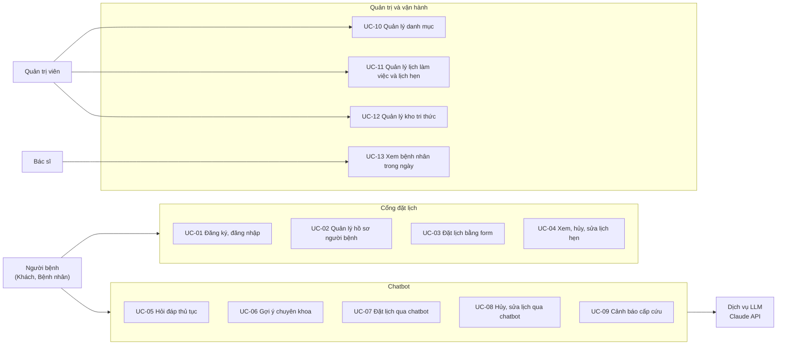
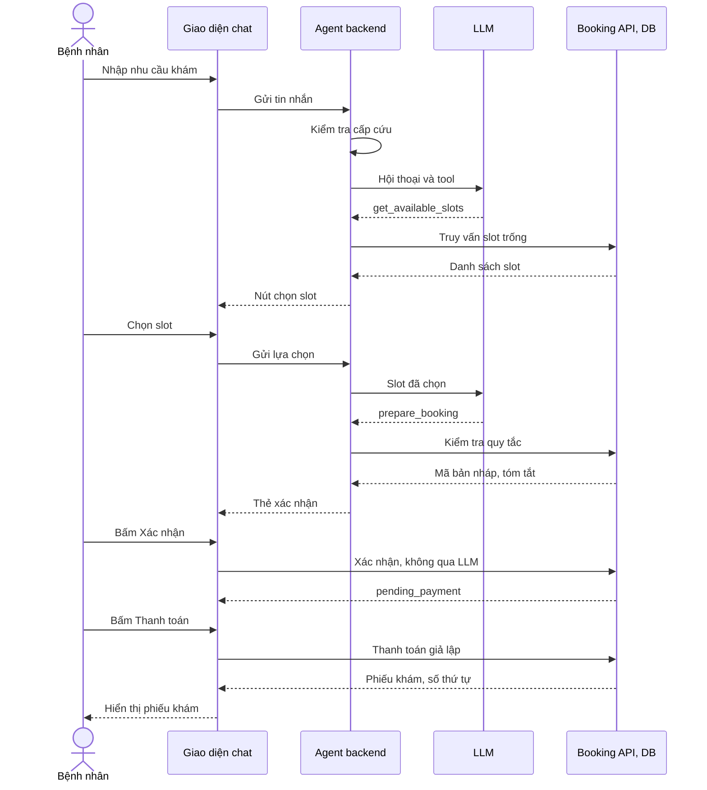
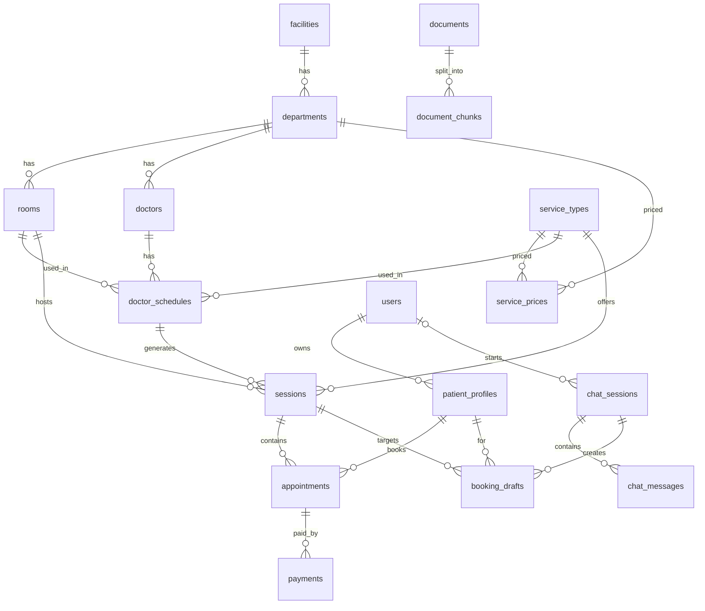
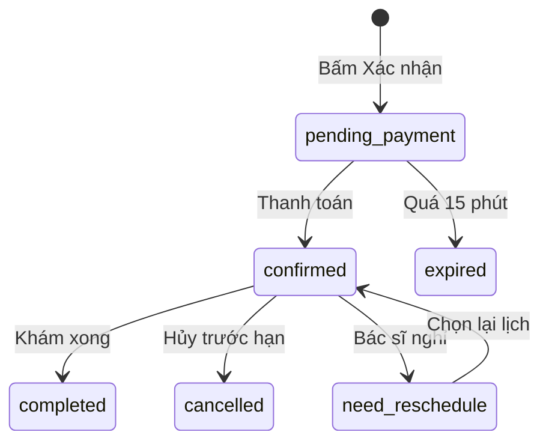

# SRS - Hệ thống đặt lịch khám và chatbot hỗ trợ người bệnh

Nov 7, 2026 · @Hieu Hoang

> Bản sao trong dự án của SRS trên Claude Docs: https://claude.ai/artifact/LgKcP8dgZDxbACbc95AmFZ
> Khi sửa một bên, cập nhật bên còn lại. Các sơ đồ ở đây được vẽ lại bằng Mermaid.

## 1. Giới thiệu

Hệ thống cho người bệnh hỏi thủ tục, được gợi ý chuyên khoa và đặt lịch khám ngay trong khung chat. Đây là bản nháp SRS cho đồ án cá nhân, chạy local, mô phỏng nghiệp vụ Cơ sở 1 của BV Đại học Y Dược TP.HCM (UMC).

### Vấn đề cần giải quyết

- Người bệnh phải tự biết mình cần khám khoa nào, vì các form đặt lịch hiện có không tư vấn.
- Quy định về BHYT, hủy lịch, sửa lịch và hoàn tiền nằm rải rác ở nhiều trang.
- Muốn hỏi thì phải gọi tổng đài, và theo Medpro, tổng đài thường quá tải vào thứ Hai và thứ Ba.

### Mục tiêu

1. Trả lời câu hỏi thủ tục dựa trên tài liệu, có trích nguồn, 24/7.
2. Gợi ý chuyên khoa từ triệu chứng mà không chẩn đoán.
3. Hoàn tất đặt, hủy, sửa lịch ngay trong hội thoại, với dữ liệu lịch thật từ hệ thống.
4. Tự áp dụng quy tắc nghiệp vụ khi tư vấn, ví dụ không có giấy chuyển tuyến thì khám trái tuyến, BHYT chi trả 50% mức hưởng.

### Phạm vi

| Trong phạm vi (MVP) | Ngoài phạm vi |
| --- | --- |
| Một bệnh viện, một cơ sở, 12 khoa lâm sàng và khoa Khám bệnh | Nền tảng nhiều bệnh viện kiểu Medpro |
| Khám thường, Phòng khám Chuyên gia, Tái khám | Gói khám sức khỏe, khám qua video, xét nghiệm tại nhà |
| Thanh toán giả lập một bước | Tích hợp cổng thanh toán thật |
| Khai báo BHYT và tư vấn mức hưởng | Xác thực thẻ BHYT với cơ quan BHXH, kết toán BHYT |
| Gợi ý chuyên khoa kèm lưu ý | Chẩn đoán, kê đơn, hồ sơ bệnh án |
| Dữ liệu mẫu tự tạo, tên bác sĩ giả định | Kết nối hệ thống thông tin bệnh viện thật |

Giao diện demo không dùng logo UMC và không dùng tên bác sĩ thật. Báo cáo cần ghi rõ dữ liệu nghiệp vụ chỉ tham khảo cho mục đích học tập.

## 2. Tác nhân

Hệ thống có 4 tác nhân người và 1 hệ thống ngoài. Chatbot là một phần của hệ thống nên không phải tác nhân; tác nhân ngoài là dịch vụ LLM mà chatbot gọi tới.

| Tác nhân | Loại | Vai trò | Quyền chính |
| --- | --- | --- | --- |
| Khách | Người | Người chưa đăng nhập | Hỏi đáp thủ tục, gợi ý chuyên khoa, xem khoa và bác sĩ |
| Bệnh nhân | Người | Chủ tài khoản, đặt lịch cho mình hoặc người thân | Mọi quyền của Khách; quản lý hồ sơ; đặt, hủy, sửa lịch |
| Bác sĩ | Người | Người khám (phần mở rộng) | Xem danh sách bệnh nhân trong ngày của mình |
| Quản trị viên | Người | Nhân viên vận hành hệ thống | Quản lý danh mục, lịch làm việc, lịch hẹn, kho tri thức |
| Dịch vụ LLM | Hệ thống ngoài | Claude API | Nhận hội thoại đã che dữ liệu, trả về câu trả lời hoặc lệnh gọi tool |

## 3. Yêu cầu chức năng

Hệ thống có 31 yêu cầu chức năng, trong đó 26 thuộc MVP và 5 thuộc phần mở rộng. Cột "Quy tắc" trỏ tới mã BR trong file docs/business-rules.md của dự án.

| Mã | Yêu cầu | Ưu tiên | Quy tắc |
| --- | --- | --- | --- |
| **Tài khoản và hồ sơ** |  |  |  |
| FR-01 | Đăng ký, đăng nhập bằng số điện thoại (OTP giả lập) | MVP | BR-11 |
| FR-02 | Quản lý nhiều hồ sơ người bệnh trong một tài khoản | MVP | BR-12 |
| FR-03 | Liên kết hồ sơ cũ bằng mã bệnh nhân | Mở rộng | BR-12a |
| **Tra cứu và đặt lịch bằng form** |  |  |  |
| FR-04 | Tra cứu khoa, bác sĩ và lịch khám theo buổi | MVP | BR-08 |
| FR-05 | Đặt lịch theo chuyên khoa | MVP | BR-12b, BR-13 |
| FR-06 | Đặt lịch theo bác sĩ | MVP | BR-12b |
| FR-07 | Sinh ca và slot 30 phút từ mẫu lịch tuần, bỏ Chủ nhật, ngày lễ và chiều thứ Bảy | MVP | BR-01 đến BR-06, BR-08 |
| FR-08 | Chặn đặt sai quy định: quá hạn, trùng giờ, vượt sức chứa slot | MVP | BR-07, BR-14, BR-15 |
| FR-09 | Khai báo đối tượng thanh toán: dịch vụ, BHYT đúng tuyến, BHYT trái tuyến, bảo lãnh | MVP | BR-19 đến BR-24 |
| FR-10 | Giả lập thanh toán, tự hủy lịch chưa thanh toán sau 15 phút | MVP | BR-16 |
| FR-11 | Cấp phiếu khám điện tử có mã QR, số thứ tự, giờ dự kiến và hướng dẫn theo đối tượng | MVP | BR-07a, BR-17, BR-25 |
| FR-12 | Xem danh sách và chi tiết lịch hẹn | MVP |  |
| FR-13 | Hủy lịch trước hạn, ghi nhận hoàn tiền | MVP | BR-26, BR-27 |
| FR-14 | Sửa lịch tối đa 1 lần trước hạn | MVP | BR-28 |
| **Chatbot** |  |  |  |
| FR-15 | Hỏi đáp thủ tục bằng RAG, có trích nguồn, không tìm thấy thì nói rõ | MVP | BR-31 |
| FR-16 | Gợi ý chuyên khoa từ triệu chứng, luôn kèm lưu ý | MVP | BR-29 |
| FR-17 | Tư vấn hình thức khám, đúng tuyến hay trái tuyến, mức hưởng | MVP | BR-18 đến BR-24 |
| FR-18 | Tra slot trống theo khoa, bác sĩ, ngày hoặc buổi | MVP | BR-01 đến BR-07 |
| FR-19 | Đặt lịch trong hội thoại, xác nhận bằng nút bấm | MVP | BR-32 |
| FR-20 | Hủy, sửa lịch trong hội thoại, giải thích được lý do nếu quá hạn | MVP | BR-26, BR-28, BR-32 |
| FR-21 | Phát hiện dấu hiệu cấp cứu ở mọi tin nhắn, dừng luồng đặt lịch | MVP | BR-04, BR-30 |
| FR-22 | Lưu lịch sử hội thoại và các lần gọi tool | MVP |  |
| FR-23 | Che số CCCD và số thẻ BHYT trước khi gửi cho LLM | MVP | BR-33 |
| **Quản trị** |  |  |  |
| FR-24 | Quản lý khoa, phòng khám, bác sĩ, hình thức khám, giá khám | MVP | BR-18 |
| FR-25 | Quản lý mẫu lịch tuần, ngày nghỉ, khám thay, khóa ca | MVP | BR-03, BR-08 đến BR-10, BR-28a |
| FR-26 | Tra cứu và xử lý lịch hẹn | MVP | BR-10 |
| FR-27 | Quản lý tài liệu tri thức, tự index lại khi tài liệu thay đổi | MVP | BR-31 |
| **Mở rộng** |  |  |  |
| FR-28 | Bác sĩ xem danh sách bệnh nhân trong ngày | Mở rộng |  |
| FR-29 | Dashboard thống kê lượt đặt, khoa đông, câu hỏi hay gặp | Mở rộng |  |
| FR-30 | Nhắc lịch qua email trước ngày khám | Mở rộng |  |
| FR-31 | Chuyển câu hỏi bot không trả lời được thành ticket cho quản trị viên | Mở rộng |  |

## 4. Yêu cầu phi chức năng

Các con số dưới đây là mục tiêu đề xuất cho đồ án, chưa phải kết quả đo được. Riêng phát hiện cấp cứu đặt mục tiêu 100% trên bộ test, vì bỏ sót là lỗi nguy hiểm nhất.

| Mã | Nhóm | Yêu cầu | Cách kiểm tra |
| --- | --- | --- | --- |
| NFR-01 | Hiệu năng | Chatbot hiện chữ đầu tiên trong 3 giây; API đặt lịch phản hồi trong 500 ms | Đo trên máy demo |
| NFR-02 | Toàn vẹn dữ liệu | 20 yêu cầu cùng lúc vào một slot không làm vượt sức chứa | Test đồng thời tự động |
| NFR-03 | Bảo mật | Mật khẩu bcrypt, xác thực JWT, phân quyền theo vai trò; người dùng chỉ thấy hồ sơ của mình | Test API với tài khoản khác |
| NFR-04 | Quyền riêng tư | Số CCCD, số thẻ BHYT không đi qua LLM; nhập qua form riêng, không nhập trong khung chat | Kiểm tra log prompt |
| NFR-05 | An toàn y tế | Phát hiện đúng 100% ca cấp cứu trong bộ test; 0 câu trả lời chẩn đoán hoặc kê đơn | Bộ test an toàn |
| NFR-06 | Chất lượng chatbot | Trả lời đúng ≥ 85% câu thủ tục; gợi ý đúng khoa ≥ 80%; hoàn tất đặt lịch ≥ 90% kịch bản | Bộ khoảng 100 câu test |
| NFR-07 | Ngôn ngữ | Hiểu tiếng Việt có dấu, không dấu và cách nói thông thường như "mai", "sáng thứ 7" | Có trong bộ test |
| NFR-08 | Khả năng cấu hình | Khoa, hình thức khám, giá, hạn chót là dữ liệu, không viết cứng trong code | Xem lại code |
| NFR-09 | Khả năng thay thế | Gọi LLM qua một lớp riêng, đổi model Claude bằng cấu hình | Đổi model, chạy lại bộ test |
| NFR-10 | Truy vết | Ghi log mọi lần gọi tool và kết quả để điều tra khi bot sai | Xem log |
| NFR-11 | Triển khai | Chạy toàn bộ bằng một lệnh Docker Compose, có script tạo dữ liệu mẫu | Cài trên máy sạch |
| NFR-12 | Giao diện | Chat và đặt lịch dùng được trên điện thoại | Thử ở độ rộng 375 px |

## 5. Use case tổng quan

Hệ thống có 13 use case, chia thành 3 nhóm. UC-07 "Đặt lịch qua chatbot" là use case trọng tâm của đồ án.

Khung tô màu là nhóm chatbot, trọng tâm của đồ án. Bảng dưới đây ghi tác nhân của từng use case.

| Mã | Use case | Tác nhân | Yêu cầu liên quan |
| --- | --- | --- | --- |
| UC-01 | Đăng ký, đăng nhập | Khách | FR-01 |
| UC-02 | Quản lý hồ sơ người bệnh | Bệnh nhân | FR-02, FR-03 |
| UC-03 | Đặt lịch bằng form | Bệnh nhân | FR-04 đến FR-11 |
| UC-04 | Xem, hủy, sửa lịch hẹn | Bệnh nhân | FR-12 đến FR-14 |
| UC-05 | Hỏi đáp thủ tục | Khách, Bệnh nhân, Dịch vụ LLM | FR-15, FR-17 |
| UC-06 | Gợi ý chuyên khoa | Khách, Bệnh nhân, Dịch vụ LLM | FR-16 |
| UC-07 | Đặt lịch qua chatbot | Bệnh nhân, Dịch vụ LLM | FR-17 đến FR-19, FR-23 |
| UC-08 | Hủy, sửa lịch qua chatbot | Bệnh nhân, Dịch vụ LLM | FR-20 |
| UC-09 | Cảnh báo cấp cứu | Khách, Bệnh nhân | FR-21 |
| UC-10 | Quản lý danh mục | Quản trị viên | FR-24 |
| UC-11 | Quản lý lịch làm việc và lịch hẹn | Quản trị viên | FR-25, FR-26 |
| UC-12 | Quản lý kho tri thức | Quản trị viên | FR-27 |
| UC-13 | Xem bệnh nhân trong ngày | Bác sĩ | FR-28 |

UC-09 được include trong mọi use case chatbot, vì mọi tin nhắn đều đi qua bước kiểm tra này. UC-07 include UC-06 khi người bệnh chưa biết khoa.

## 6. Đặc tả UC-07: Đặt lịch qua chatbot

LLM chỉ được chuẩn bị bản nháp lịch hẹn, không được tự tạo lịch. Lịch hẹn chỉ sinh ra khi người bệnh bấm nút Xác nhận, và lệnh này đi thẳng từ giao diện tới backend, không qua LLM. Nhờ vậy bot có hiểu sai cũng không đặt nhầm lịch được (BR-32).

| Mục | Nội dung |
| --- | --- |
| Tác nhân chính | Bệnh nhân |
| Tác nhân phụ | Dịch vụ LLM |
| Tiền điều kiện | Người dùng đã mở khung chat. Đăng nhập chỉ bắt buộc từ bước 5 |
| Kết quả thành công | Lịch hẹn ở trạng thái `confirmed`, có số thứ tự và phiếu khám điện tử |
| Kết quả thất bại | Không có lịch hẹn nào được giữ, thông tin đã thu thập còn trong hội thoại |
| Quy tắc áp dụng | BR-01 đến BR-07a, BR-12 đến BR-25, BR-29 đến BR-33 |

### Luồng chính

1. Bệnh nhân nêu nhu cầu, ví dụ "Đặt cho mẹ tôi khám tim sáng thứ 7".
2. Hệ thống kiểm tra dấu hiệu cấp cứu (UC-09). Không có dấu hiệu thì đi tiếp.
3. Bot rút ra các thông tin: người khám, khoa hoặc triệu chứng, bác sĩ, ngày hoặc buổi, có BHYT hay không. Thiếu gì hỏi nấy, mỗi lần một câu.
4. Nếu chưa biết khoa, bot gợi ý chuyên khoa kèm lưu ý (UC-06).
5. Bot gọi `get_profiles` và hiển nút chọn hồ sơ. Bệnh nhân chọn hồ sơ.
6. Bot xác định đối tượng thanh toán và nêu giấy tờ cần mang (BR-19 đến BR-24).
7. Bot gọi `get_available_slots` và hiển tối đa 5 slot dưới dạng nút bấm.
8. Bệnh nhân chọn slot.
9. Bot gọi `prepare_booking`. Backend kiểm tra toàn bộ quy tắc và tạo bản nháp, chưa giữ chỗ.
10. Giao diện hiện thẻ tóm tắt: người khám, khoa, bác sĩ, ngày giờ, giá, đối tượng thanh toán.
11. Bệnh nhân bấm Xác nhận. Backend tạo lịch `pending_payment` trong một transaction và giữ slot 15 phút.
12. Bệnh nhân bấm Thanh toán (giả lập). Lịch chuyển sang `confirmed` và được cấp số thứ tự.
13. Khung chat hiện phiếu khám điện tử và hướng dẫn khi đến viện theo đối tượng (BR-25).

Đường nét đứt là phản hồi. Đường tô màu là bước xác nhận, nơi LLM không có mặt.

### Luồng thay thế

| Mã | Tại bước | Tình huống | Xử lý |
| --- | --- | --- | --- |
| A1 | 3 | Bệnh nhân nêu tên bác sĩ | Đi theo luồng đặt theo bác sĩ, bỏ qua bước 4 |
| A2 | 5 | Chưa đăng nhập | Bot mời đăng nhập, giữ nguyên ngữ cảnh, quay lại bước 5 |
| A3 | 5 | Người khám chưa có hồ sơ | Mở form tạo hồ sơ ngay trong khung chat. CCCD và số BHYT nhập ở form, không nhập trong tin nhắn (BR-33) |
| A4 | 6 | Có BHYT nhưng không có giấy chuyển tuyến | Bot giải thích diện trái tuyến và mức hưởng. Nếu đồng ý, mở form đính kèm ảnh CCCD và cam kết (BR-22) |
| A5 | 6 | Giấy chuyển tuyến sẽ hết hạn trước ngày khám | Bot cảnh báo và gợi ý ngày sớm hơn (BR-21) |
| A6 | 7 | Ngày yêu cầu không khám (Chủ nhật, ngày lễ, chiều thứ Bảy) | Bot nêu lý do và gợi ý ngày khám gần nhất (BR-02, BR-03) |
| A7 | 7 | Hết slot | Bot gợi ý ngày khác hoặc bác sĩ khác cùng khoa |
| A8 | 10 | Bệnh nhân muốn đổi thông tin | Bấm Sửa, bản nháp bị bỏ, quay lại bước tương ứng |

### Luồng ngoại lệ

| Mã | Tại bước | Tình huống | Xử lý |
| --- | --- | --- | --- |
| E1 | Mọi bước | Có dấu hiệu cấp cứu | Dừng luồng, bỏ bản nháp, hướng dẫn gọi 115 hoặc đến Cấp cứu (BR-30) |
| E2 | 9 | Vi phạm quy tắc: trùng giờ, quá 3 lịch một ngày, quá hạn 16h30, trộn đúng tuyến và trái tuyến | Tool trả mã lỗi, bot giải thích bằng lời và đề xuất cách khác |
| E3 | 11 | Slot vừa hết do người khác đặt trước (BR-15) | Báo slot không còn, quay lại bước 7 |
| E4 | 11 | Bản nháp hết hạn hoặc bị bấm trùng | Backend từ chối, không tạo lịch thứ hai |
| E5 | 12 | Quá 15 phút chưa thanh toán | Lịch chuyển sang `expired`, trả slot, bot thông báo (BR-16) |
| E6 | Mọi bước | LLM hoặc kho tri thức lỗi | Bot báo lỗi và chuyển sang form UC-03, điền sẵn thông tin đã có |
| E7 | Mọi bước | Người dùng hỏi chẩn đoán hoặc kê đơn | Bot từ chối phần đó và quay lại việc đặt lịch (BR-29) |

### Tool của chatbot

Mọi tool chạy với quyền của người đang đăng nhập. `user_id` lấy từ phiên đăng nhập, không lấy từ LLM.

| Tool | Đầu vào chính | Đầu ra | Thay đổi dữ liệu |
| --- | --- | --- | --- |
| `search_docs` | Câu hỏi | Đoạn tài liệu kèm nguồn | Không |
| `suggest_department` | Triệu chứng | Khoa gợi ý | Không |
| `get_profiles` | Không | Hồ sơ của tài khoản, đã che dữ liệu | Không |
| `get_doctors` | Khoa | Danh sách bác sĩ và buổi khám | Không |
| `get_available_slots` | Khoa hoặc bác sĩ, khoảng ngày | Slot còn trống | Không |
| `prepare_booking` | Hồ sơ, slot, hình thức khám, đối tượng thanh toán | Mã bản nháp và tóm tắt, hoặc mã lỗi | Chỉ tạo bản nháp |

## 7. Đặc tả rút gọn các use case chính khác

Các use case dưới đây được đặc tả ở mức luồng chính và ngoại lệ quan trọng nhất. Các use case CRUD đơn giản (UC-01, UC-02, UC-10) không cần đặc tả riêng.

### UC-03: Đặt lịch bằng form

1. Bệnh nhân chọn đặt theo chuyên khoa hoặc theo bác sĩ.
2. Chọn hồ sơ, hình thức khám, đối tượng thanh toán.
3. Chọn ngày, rồi chọn slot còn trống.
4. Kiểm tra thông tin và xác nhận, sau đó thanh toán giả lập.
5. Nhận phiếu khám điện tử.

UC-03 và UC-07 dùng chung một API đặt lịch, nên quy tắc chỉ cài đặt một lần. Ngoại lệ chính: slot vừa hết thì báo lỗi và tải lại danh sách slot.

### UC-04 và UC-08: Hủy, sửa lịch hẹn

1. Bệnh nhân chọn lịch hẹn trên trang, hoặc nói với bot, ví dụ "Hủy lịch khám ngày mai".
2. Hệ thống kiểm tra hạn: hủy trước 15h00 và sửa trước 16h30 ngày trước ngày khám, sửa tối đa 1 lần.
3. Hệ thống hiện thẻ tóm tắt, bệnh nhân bấm xác nhận (không qua LLM, như UC-07).
4. Hủy: lịch sang `cancelled`, thanh toán sang `refunded`, trả slot. Sửa: đổi slot và cấp lại số thứ tự.

Ngoại lệ chính: quá hạn thì từ chối, nêu giờ hạn đã qua và hướng dẫn gọi tổng đài.

### UC-05: Hỏi đáp thủ tục

1. Người dùng đặt câu hỏi, ví dụ "Không có giấy chuyển tuyến có khám BHYT được không?".
2. Bot gọi `search_docs`, lấy các đoạn liên quan nhất trong kho tri thức.
3. Bot trả lời chỉ dựa trên các đoạn đó và nêu nguồn.

Ngoại lệ chính: không tìm thấy thì nói rõ không có thông tin và gợi ý tổng đài 1900 2827 (BR-31).

### UC-06: Gợi ý chuyên khoa

1. Người dùng mô tả triệu chứng.
2. Bot hỏi thêm tối đa 2 câu nếu mô tả chưa đủ.
3. Bot gọi `suggest_department`, tool này tra bảng ánh xạ triệu chứng sang khoa.
4. Bot đưa ra 1–2 khoa kèm lưu ý "Chỉ là gợi ý, không thay thế chẩn đoán của bác sĩ", rồi mời đặt lịch.

Ngoại lệ chính: không xác định được khoa thì gợi ý khoa Khám bệnh để bác sĩ khám ban đầu chuyển khoa phù hợp.

### UC-09: Cảnh báo cấp cứu

1. Mọi tin nhắn đi qua bước kiểm tra trước khi tới LLM: danh sách từ khóa, rồi bước phân loại.
2. Nếu có dấu hiệu nguy hiểm, hệ thống trả câu cảnh báo cố định: gọi 115 hoặc đến khoa Cấp cứu, số (028) 3952 5515.
3. Luồng đặt lịch dừng lại. Người dùng có thể tiếp tục nếu xác nhận đây không phải tình huống khẩn cấp.

Câu cảnh báo cố định, không do LLM sinh ra, nên vẫn hoạt động khi LLM lỗi. Ưu tiên báo nhầm hơn là bỏ sót.

### UC-11: Quản lý lịch làm việc

1. Quản trị viên khai báo mẫu lịch tuần cho bác sĩ, ví dụ "Sáng thứ Hai, phòng 12".
2. Hệ thống sinh ca khám theo ngày cho 30 ngày tới, bỏ ngày lễ.
3. Quản trị viên khai báo khám thay hoặc khóa ca khi bác sĩ nghỉ.

Khi khóa ca: trước 16h30 hôm trước thì lịch hẹn sang `need_reschedule` để người bệnh chọn lại. Sau mốc đó thì bắt buộc chỉ định bác sĩ khám thay (BR-10, BR-28a).

### UC-12: Quản lý kho tri thức

1. Quản trị viên tải lên hoặc sửa tài liệu markdown.
2. Hệ thống chia đoạn, tạo embedding và cập nhật vector DB.
3. Quản trị viên thử một câu hỏi để kiểm tra kết quả.

Ngoại lệ chính: index lỗi thì giữ bản cũ đang chạy và báo lỗi cho quản trị viên.

## 8. Thiết kế dữ liệu (ERD)

Cơ sở dữ liệu có 18 bảng, trung tâm là `appointments`. Mỗi lịch hẹn nối một hồ sơ người bệnh với một ca khám cụ thể.

Mũi tên đi từ phía 1 sang phía n. Nét đứt từ `holidays` chỉ là quy tắc sinh ca, không phải khóa ngoại. Sơ đồ lược bớt bảng `service_prices`, cùng các khóa ngoại phụ ghi ở bảng dưới đây.

### Mô tả các bảng

| Bảng | Mục đích | Cột chính |
| --- | --- | --- |
| `facilities` | Cơ sở bệnh viện, sẵn sàng mở rộng | id, name, address, hotline |
| `departments` | Chuyên khoa | id, facility_id, name, description |
| `rooms` | Phòng khám | id, department_id, name, area, floor |
| `service_types` | Hình thức khám | id, name, allow_bhyt, choose_doctor |
| `service_prices` | Giá khám theo khoa và hình thức | department_id, service_type_id, amount |
| `doctors` | Bác sĩ | id, department_id, user_id, title, full_name, bio |
| `doctor_schedules` | Mẫu lịch tuần | id, doctor_id, room_id, service_type_id, weekday, shift, slot_minutes, capacity_per_slot |
| `sessions` | Ca khám theo ngày, sinh từ mẫu tuần | id, schedule_id, doctor_id, substitute_doctor_id, room_id, service_type_id, date, start_time, end_time, slot_minutes, capacity_per_slot, status |
| `holidays` | Ngày nghỉ, không sinh ca | date, name |
| `users` | Tài khoản | id, phone, password_hash, role, full_name, email |
| `patient_profiles` | Hồ sơ người bệnh | id, user_id, full_name, dob, gender, relation, id_number_enc, bhyt_code_enc, bhyt_rate, hospital_patient_code, phone, email, address |
| `appointments` | Lịch hẹn | id, code, profile_id, session_id, slot_time, queue_no, estimated_time, payer_type, referral_expiry, symptoms, status, edit_count, channel, hold_expires_at |
| `payments` | Thanh toán giả lập | id, appointment_id, amount, method, status, paid_at, refunded_at |
| `chat_sessions` | Phiên chat, khách thì user_id rỗng | id, user_id, created_at |
| `chat_messages` | Tin nhắn và lần gọi tool | id, session_id, role, content, tool_calls, sources |
| `booking_drafts` | Bản nháp do bot tạo, chờ người bệnh xác nhận | id, chat_session_id, profile_id, session_id, slot_time, payer_type, status, expires_at |
| `documents` | Tài liệu tri thức | id, title, category, source_url, retrieved_at, content, status |
| `document_chunks` | Đoạn tài liệu để tìm kiếm | id, document_id, chunk_index, text, embedding |

### Ràng buộc quan trọng

- **Chống vượt sức chứa slot (BR-15):** khóa dòng `sessions` bằng `SELECT ... FOR UPDATE`, đếm lịch còn hiệu lực trong slot, rồi mới tạo lịch.
- **Chống trùng giờ (BR-14):** unique index một phần trên `(profile_id, slot_time)` cho các lịch còn hiệu lực.
- **Chống bấm xác nhận hai lần:** `booking_drafts.status` chỉ đổi từ `open` sang `used` được một lần.
- **Số thứ tự (BR-07a):** cấp theo thứ tự thanh toán trong từng ca khám.
- **Dữ liệu nhạy cảm:** số CCCD và số thẻ BHYT mã hóa khi lưu, các cột có hậu tố `_enc`.

### Trạng thái lịch hẹn

Hoàn tiền nằm ở `payments.status`, nên lịch hẹn chỉ cần 6 trạng thái.

## 9. Giả định và quyết định đã chốt

Mọi điểm mở đã được chốt ngày 07/11/2026. Đây là bản demo nên quy định chỉ cần sát thực tế, không cần chính xác tuyệt đối. Báo cáo cần ghi rõ các dòng loại "Giả định" và ghi dữ liệu nghiệp vụ chỉ để tham khảo.

| Vấn đề | Quyết định | Loại |
| --- | --- | --- |
| Hạn hủy lịch | Trước 15h00 ngày trước ngày khám | Theo Medpro |
| Giờ bắt đầu khám | 07h00. Khung giờ là sáng 07h00–12h00, chiều 13h00–16h30, thứ Bảy chỉ buổi sáng | Theo Medpro |
| Giá khám | Khám thường và Tái khám 150.000đ, Phòng khám Chuyên gia 300.000đ | 150.000đ theo Medpro; 300.000đ là giả định vì không đọc được Bảng giá của UMC |
| Slot và giữ chỗ | Slot 30 phút, 3 người một slot, tối đa 3 lịch một ngày, giữ chỗ 15 phút | Giả định |
| Đặt lịch trong ngày | Không cho phép, chỉ đặt trước 1–30 ngày | Theo Medpro |
| Bảo lãnh viện phí | Chỉ ghi nhận đối tượng thanh toán và hướng dẫn đến quầy, không xử lý thủ tục với công ty bảo hiểm | Giới hạn phạm vi |
| LLM | Claude API | Quyết định kỹ thuật |
| Vector DB | pgvector: miễn phí, chạy ngay trong PostgreSQL có sẵn nên không thêm dịch vụ nào. Giữ nguyên bảng `document_chunks` ở mục 8 | Quyết định kỹ thuật |
| Thanh toán khi có BHYT | Demo thu đủ phí khám, mức hưởng BHYT chỉ để tư vấn. Khám trái tuyến chỉ cần tick cam kết; tải ảnh CCCD làm cùng frontend | Giả định |

## Nguồn

Các trang dưới đây được đọc ngày 26/10/2026. Ngoài ra, đồ án có 15 file tri thức trong thư mục knowledge/ và hai tài liệu docs/business-rules.md, docs/research-medpro.md.

- [BV ĐHYD: Câu hỏi thường gặp](https://bvdaihoc.com.vn/cau-hoi-thuong-gap)
- [BV ĐHYD: Hướng dẫn đặt lịch khám trực tuyến](https://bvdaihoc.com.vn/thong-tin-can-biet/huong-dan-dat-lich-kham-benh-truc-tuyen)
- [BV ĐHYD: Thủ tục BHYT đúng tuyến](https://bvdaihoc.com.vn/thong-tin-can-biet/huong-dan-thu-tuc-kham-chua-benh-bao-hiem-y-te-dung-tuyen)
- [BV ĐHYD: Thủ tục BHYT trái tuyến từ 01/07/2026](https://bvdaihoc.com.vn/thong-tin-can-biet/huong-dan-thu-tuc-kham-chua-benh-bao-hiem-y-te-trai-tuyen-tai-benh-vien-dai-hoc-y-duoc-tp-ho-chi-minh-tu-ngay-01072026)
- [BV ĐHYD: Quy trình hoàn tiền](https://bvdaihoc.com.vn/thong-tin-can-biet/quy-trinh-hoan-tien-phi-dich-vu-tai-benh-vien)
- [BV ĐHYD: Lịch khám bệnh](https://bvdaihoc.com.vn/lich-kham-benh)
- [Medpro: Quy định sử dụng](https://medpro.vn/quy-dinh-su-dung)
- [Medpro: Hướng dẫn đi khám BV ĐHYD cơ sở 1](https://medpro.vn/tin-tuc/huong-dan-di-kham-benh-vien-dh-y-duoc-cs1)
- [Medpro: Khám dịch vụ BV ĐHYD](https://medpro.vn/tin-tuc/kham-dich-vu-bv-dai-hoc-y-duoc-tphcm)
- [Medpro: Đặt lịch khám, lấy số thứ tự](https://medpro.vn/tin-tuc/dat-lich-kham-lay-so-thu-tu-tren-medpro)
